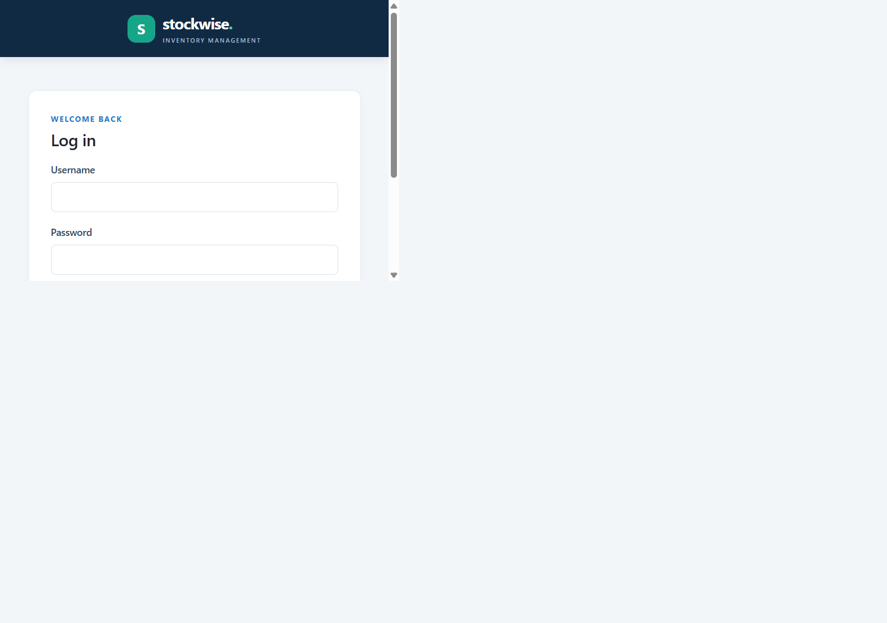
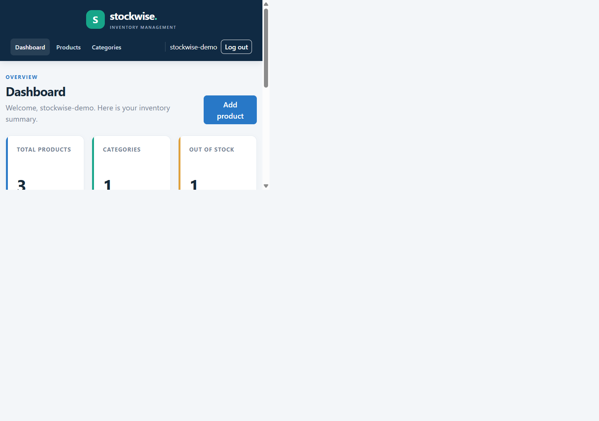
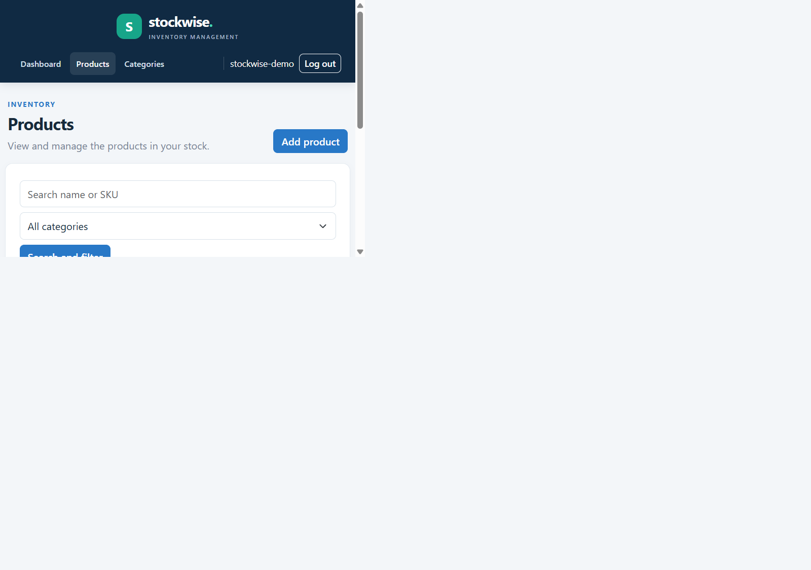
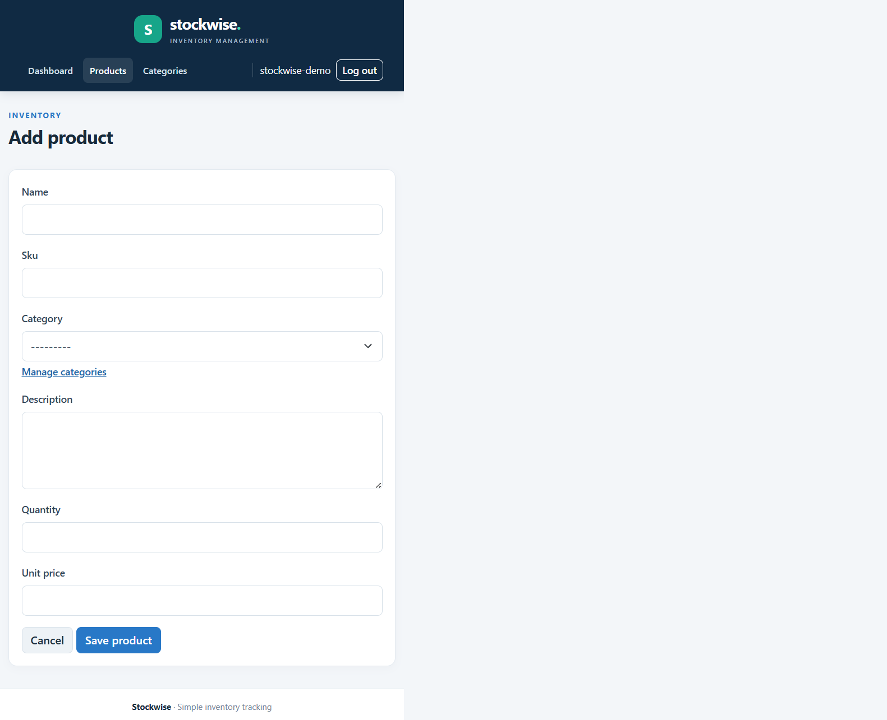
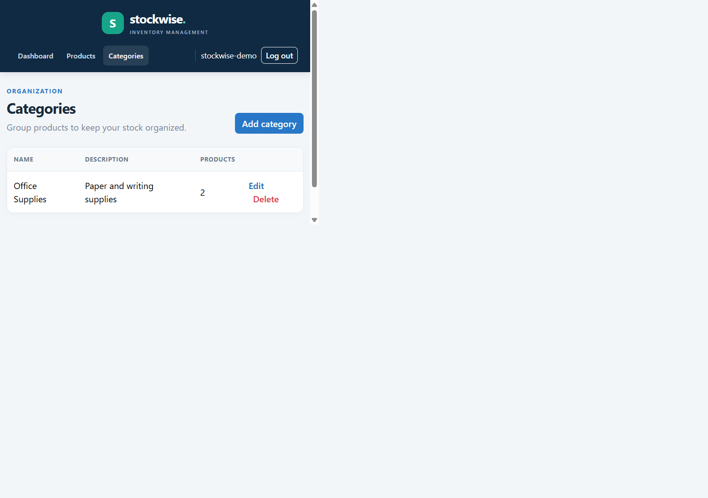

# Stockwise Inventory Management

## Introduction

Stockwise is a small web application for keeping track of products in a store. Users can register, log in, and manage their own products and categories.

## Objectives

- Add, view, edit, and delete products.
- Organize products into categories.
- Search for a product by name or SKU and filter by category.
- See a simple summary of products on the dashboard.

## Technologies Used

- Python and Django
- MySQL
- HTML, CSS, Bootstrap, and JavaScript

## System Requirements

- Python 3.10 or later
- MySQL 8 or later
- A web browser
- Internet access to load Bootstrap from its CDN

## Installation and Running

1. Open a terminal in this folder.
2. Create and activate a virtual environment:

   ```powershell
   python -m venv .venv
   .venv\Scripts\Activate.ps1
   ```

3. Install the project packages:

   ```powershell
   pip install -r requirements.txt
   ```

4. Open MySQL Workbench, connect to your local MySQL server using your MySQL
   administrator account, and run these statements. Replace the example
   password with one you choose:

   ```sql
   CREATE DATABASE inventory_management;
   CREATE USER 'inventory_user'@'localhost' IDENTIFIED BY 'ChooseYourOwnPassword';
   GRANT ALL PRIVILEGES ON inventory_management.* TO 'inventory_user'@'localhost';
   ```

   If you already created the database or account, skip the matching
   `CREATE` statement.

5. In the project folder, create a file named `.env` and add your database
   settings. Replace the sample password with the one you chose above:

   ```text
   DB_NAME=inventory_management
   DB_USER=inventory_user
   DB_PASSWORD=ChooseYourOwnPassword
   DB_HOST=localhost
   DB_PORT=3306
   ```

   Keep `.env` private. It is excluded from GitHub by `.gitignore`.
6. Open PowerShell in the project folder and create the tables and start the
   website:

   ```powershell
   python manage.py migrate
   python manage.py runserver
   ```

7. Open `http://127.0.0.1:8000/` in a browser and register an account.

For local development, `DEBUG` is enabled by default so Django's development
server can serve the CSS and JavaScript files. Set `DJANGO_DEBUG=False` when
deploying the project.

## Database Design

Django's built-in user table stores accounts.

- **Category:** belongs to a user and stores a name, description, and creation date.
- **Product:** belongs to a user and can have a category. It stores a name, SKU, description, quantity, unit price, and creation date.
- A user's product SKUs and category names must be unique.
- Deleting a category keeps its products and clears their category.

## Modules

- **Accounts:** user registration, login, and logout.
- **Inventory:** dashboard, product and category forms, lists, search, filtering, and delete confirmations.
- **Templates and static files:** Bootstrap pages, a small CSS file, and client-side form validation.

## Testing

The tests use a temporary SQLite database so they can run without connecting to MySQL:

```powershell
python manage.py test --settings=inventory_project.test_settings
```

## Screenshots

These screenshots use example data:







## Project Demonstration

1. Register a new account and show the dashboard.
2. Show that the account has a default **General** category.
3. Add a category, then add a product and assign it to that category.
4. Open the product, edit its details, and save the changes.
5. Search for the product and filter the product list by its category.
6. Delete the product and category, and show that the dashboard counts update.
7. Log out and show that the app asks the user to log in before opening the dashboard.

## Viva Preparation

- **What does Django do here?** It connects the Python code, database, forms, and web pages.
- **What are the main database models?** `Category` stores a user's categories, and `Product` stores their inventory items.
- **What does a view do?** A view handles a web request, reads or updates records, and selects the page to return.
- **What does a form do?** A form collects input and checks it before saving it to the database.
- **How are products searched and filtered?** The product view filters the current user's products by name, SKU, or selected category.
- **How does the app keep user data separate?** Each product and category is linked to its owner, and inventory views only access records belonging to the signed-in user.
- **Why is SQLite used in the test command?** It gives the automated tests a temporary database; the actual app is configured to use MySQL.

## GitHub Repository

https://github.com/Sivakumar1905/stockwise-inventory-management

## Conclusion

This project demonstrates a basic Django application with accounts, database-backed product management, forms, and responsive pages.
